# 绣灵志 · Batch 08：通关卡与章节过场

**24 张 PNG：6 张章节通关卡 + 18 张章节过场（6 组，每组 3 幕）。**

使用内置图像生成器，沿用刺绣 / 十字绣质感与既有角色参考。所选 PNG 为生成器原始输出字节；没有脚本缩放、裁切、抠图或重编码。AI 修订草稿保留于本地，仓库只包含最终选择。

## 尺寸与验收边界

- 1671×941：2 张。
- 1672×940：1 张。
- 1672×941：21 张。
- 与目标差 1 像素的 3 张：clear-ch4.png（高度）、bridge-2to3-b.png 与 bridge-6to7-a.png（宽度）；保留原图，不自动校正。
- 已逐张目视检查：未发现可辨文字、外框、水印或对白框；通关卡主体下移、镜泊倒影上移，主要剧情位于各自 UI 留白之外。
- **不是全部严格规格通过。** 个别边缘装饰 / 地面针脚进入 UI 区；角色表情、数量细节、道具和镜像仍有生成偏差，详见逐张说明。没有在游戏中实际叠加标题 / 旁白测试。
- 这些是场景插画，不是可直接切割的精灵表；纹理较原始精灵更细，未验证固定 6–7 px 像素节距，也未进行像素级角色配准。
- 第六至第七章三幕没有实体灯芯童，只有第一幕炉火中的光影；第三章通关卡未描绘读信 / 焚信分支。
- 没有修改游戏代码或部署；本次交付仅资产。来源提示词、过程日志和本机路径未公开。

## 原图目录

| 文件 | 场景 | 实际尺寸 | 下载 |
|---|---|---|---|
| [clear-ch1.png](clear-ch1.png) | 第一章通关：钟声重归 | 1672×941 | [PNG](https://raw.githubusercontent.com/0xuezhang985/folklore-sprite-grids/main/clear-ch1.png) |
| [clear-ch2.png](clear-ch2.png) | 第二章通关：雾散送行 | 1672×941 | [PNG](https://raw.githubusercontent.com/0xuezhang985/folklore-sprite-grids/main/clear-ch2.png) |
| [clear-ch3.png](clear-ch3.png) | 第三章通关：纸鸢安睡 | 1672×941 | [PNG](https://raw.githubusercontent.com/0xuezhang985/folklore-sprite-grids/main/clear-ch3.png) |
| [clear-ch4.png](clear-ch4.png) | 第四章通关：影子归家 | 1672×940 | [PNG](https://raw.githubusercontent.com/0xuezhang985/folklore-sprite-grids/main/clear-ch4.png) |
| [clear-ch5.png](clear-ch5.png) | 第五章通关：绣城修复 | 1672×941 | [PNG](https://raw.githubusercontent.com/0xuezhang985/folklore-sprite-grids/main/clear-ch5.png) |
| [clear-ch6.png](clear-ch6.png) | 第六章通关：守岁共饮 | 1672×941 | [PNG](https://raw.githubusercontent.com/0xuezhang985/folklore-sprite-grids/main/clear-ch6.png) |
| [bridge-1to2-a.png](bridge-1to2-a.png) | 林外钟声 | 1672×941 | [PNG](https://raw.githubusercontent.com/0xuezhang985/folklore-sprite-grids/main/bridge-1to2-a.png) |
| [bridge-1to2-b.png](bridge-1to2-b.png) | 林边篷车 | 1672×941 | [PNG](https://raw.githubusercontent.com/0xuezhang985/folklore-sprite-grids/main/bridge-1to2-b.png) |
| [bridge-1to2-c.png](bridge-1to2-c.png) | 驶入雾沼 | 1672×941 | [PNG](https://raw.githubusercontent.com/0xuezhang985/folklore-sprite-grids/main/bridge-1to2-c.png) |
| [bridge-2to3-a.png](bridge-2to3-a.png) | 灯芯童上车 | 1672×941 | [PNG](https://raw.githubusercontent.com/0xuezhang985/folklore-sprite-grids/main/bridge-2to3-a.png) |
| [bridge-2to3-b.png](bridge-2to3-b.png) | 逆风上山 | 1671×941 | [PNG](https://raw.githubusercontent.com/0xuezhang985/folklore-sprite-grids/main/bridge-2to3-b.png) |
| [bridge-2to3-c.png](bridge-2to3-c.png) | 无人收取的信 | 1672×941 | [PNG](https://raw.githubusercontent.com/0xuezhang985/folklore-sprite-grids/main/bridge-2to3-c.png) |
| [bridge-3to4-a.png](bridge-3to4-a.png) | 信鸽登车 | 1672×941 | [PNG](https://raw.githubusercontent.com/0xuezhang985/folklore-sprite-grids/main/bridge-3to4-a.png) |
| [bridge-3to4-b.png](bridge-3to4-b.png) | 湖畔宿营 | 1672×941 | [PNG](https://raw.githubusercontent.com/0xuezhang985/folklore-sprite-grids/main/bridge-3to4-b.png) |
| [bridge-3to4-c.png](bridge-3to4-c.png) | 多出的倒影 | 1672×941 | [PNG](https://raw.githubusercontent.com/0xuezhang985/folklore-sprite-grids/main/bridge-3to4-c.png) |
| [bridge-4to5-a.png](bridge-4to5-a.png) | 热茶与归来 | 1672×941 | [PNG](https://raw.githubusercontent.com/0xuezhang985/folklore-sprite-grids/main/bridge-4to5-a.png) |
| [bridge-4to5-b.png](bridge-4to5-b.png) | 草地化线 | 1672×941 | [PNG](https://raw.githubusercontent.com/0xuezhang985/folklore-sprite-grids/main/bridge-4to5-b.png) |
| [bridge-4to5-c.png](bridge-4to5-c.png) | 绣城迎客 | 1672×941 | [PNG](https://raw.githubusercontent.com/0xuezhang985/folklore-sprite-grids/main/bridge-4to5-c.png) |
| [bridge-5to6-a.png](bridge-5to6-a.png) | 车内补衣 | 1672×941 | [PNG](https://raw.githubusercontent.com/0xuezhang985/folklore-sprite-grids/main/bridge-5to6-a.png) |
| [bridge-5to6-b.png](bridge-5to6-b.png) | 风雪失散 | 1672×941 | [PNG](https://raw.githubusercontent.com/0xuezhang985/folklore-sprite-grids/main/bridge-5to6-b.png) |
| [bridge-5to6-c.png](bridge-5to6-c.png) | 雪中炉火 | 1672×941 | [PNG](https://raw.githubusercontent.com/0xuezhang985/folklore-sprite-grids/main/bridge-5to6-c.png) |
| [bridge-6to7-a.png](bridge-6to7-a.png) | 不灭的微光 | 1671×941 | [PNG](https://raw.githubusercontent.com/0xuezhang985/folklore-sprite-grids/main/bridge-6to7-a.png) |
| [bridge-6to7-b.png](bridge-6to7-b.png) | 掀起雪地一角 | 1672×941 | [PNG](https://raw.githubusercontent.com/0xuezhang985/folklore-sprite-grids/main/bridge-6to7-b.png) |
| [bridge-6to7-c.png](bridge-6to7-c.png) | 织锦背面 | 1672×941 | [PNG](https://raw.githubusercontent.com/0xuezhang985/folklore-sprite-grids/main/bridge-6to7-c.png) |

## 预览

### 章节通关卡

**第一章通关：钟声重归**

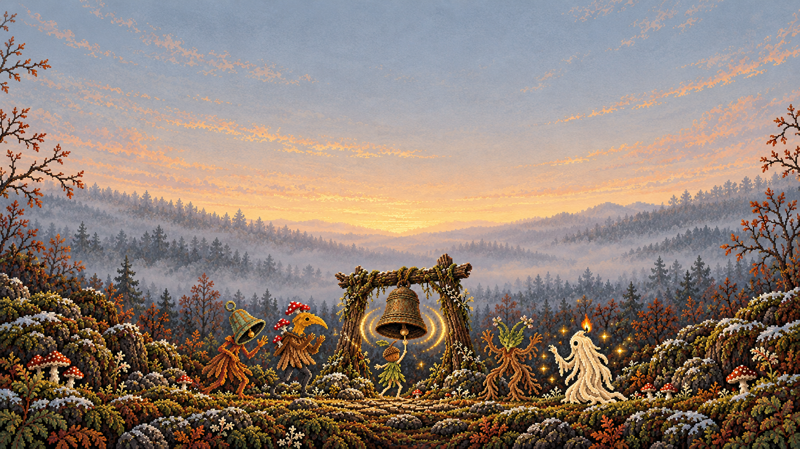

**第二章通关：雾散送行**

**第三章通关：纸鸢安睡**

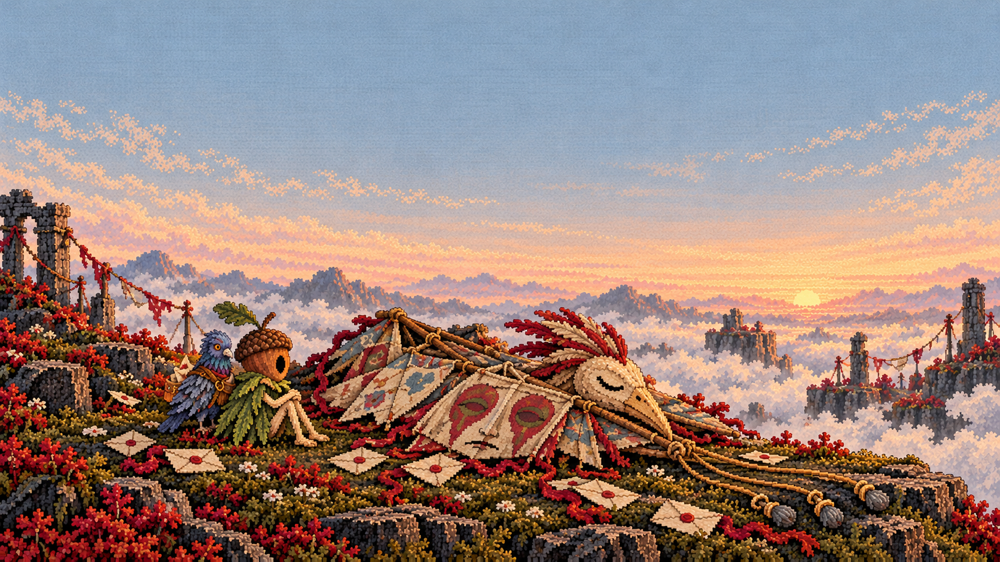

**第四章通关：影子归家**

**第五章通关：绣城修复**

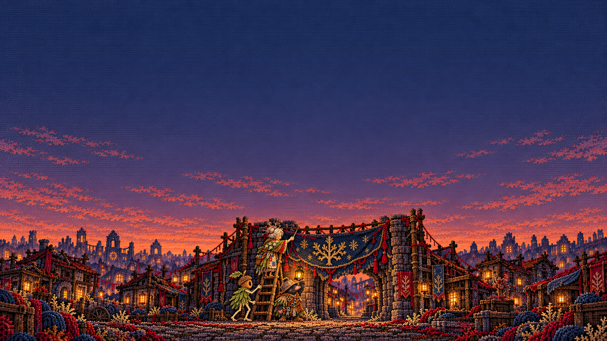

**第六章通关：守岁共饮**

### 第 1 → 2 章

| 第一幕 | 第二幕 | 第三幕 |
|---|---|---|
| 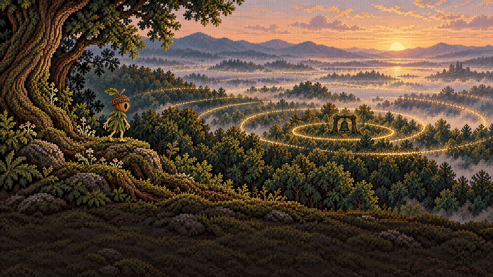 | 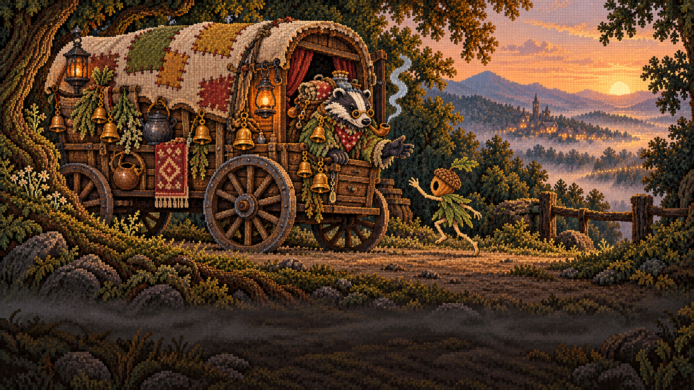 | 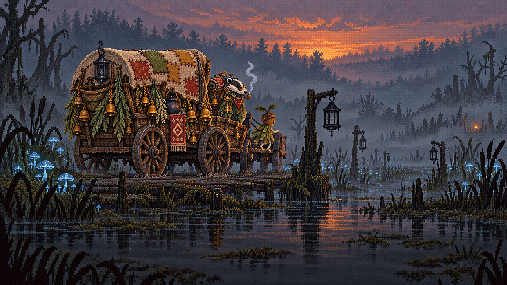 |

### 第 2 → 3 章

| 第一幕 | 第二幕 | 第三幕 |
|---|---|---|
|  | 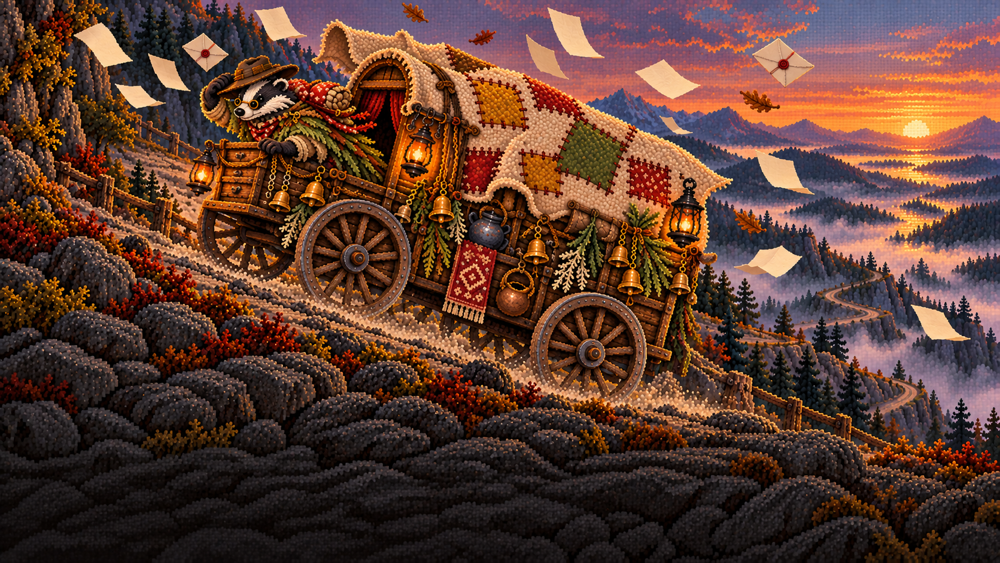 | 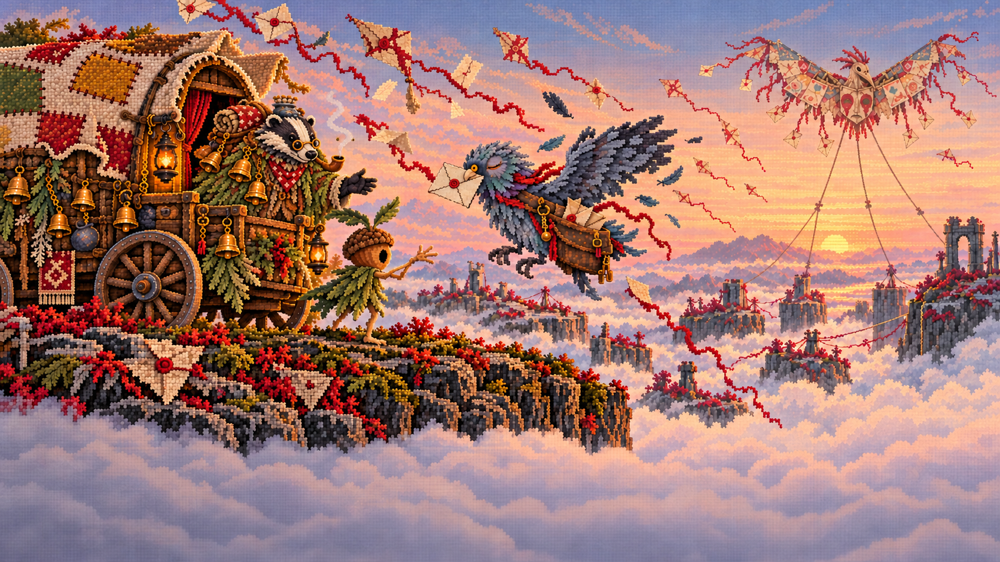 |

### 第 3 → 4 章

| 第一幕 | 第二幕 | 第三幕 |
|---|---|---|
| 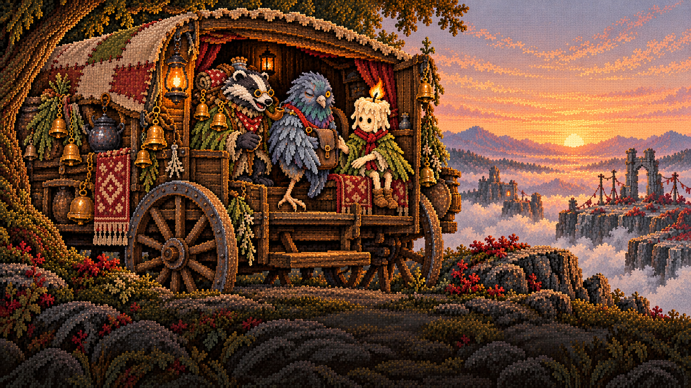 |  |  |

### 第 4 → 5 章

| 第一幕 | 第二幕 | 第三幕 |
|---|---|---|
| 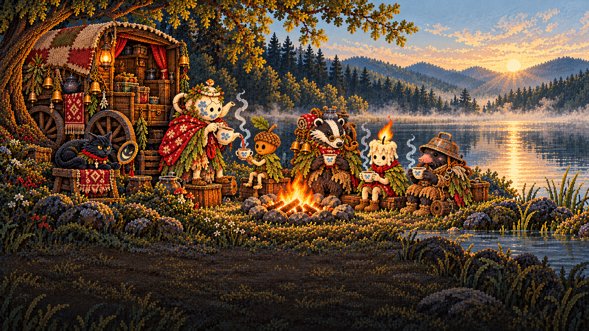 | 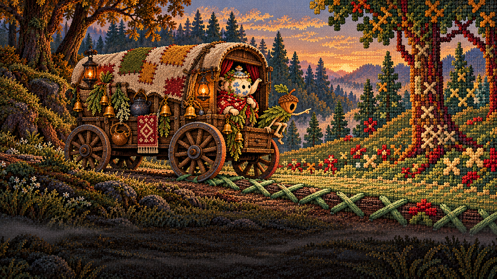 | 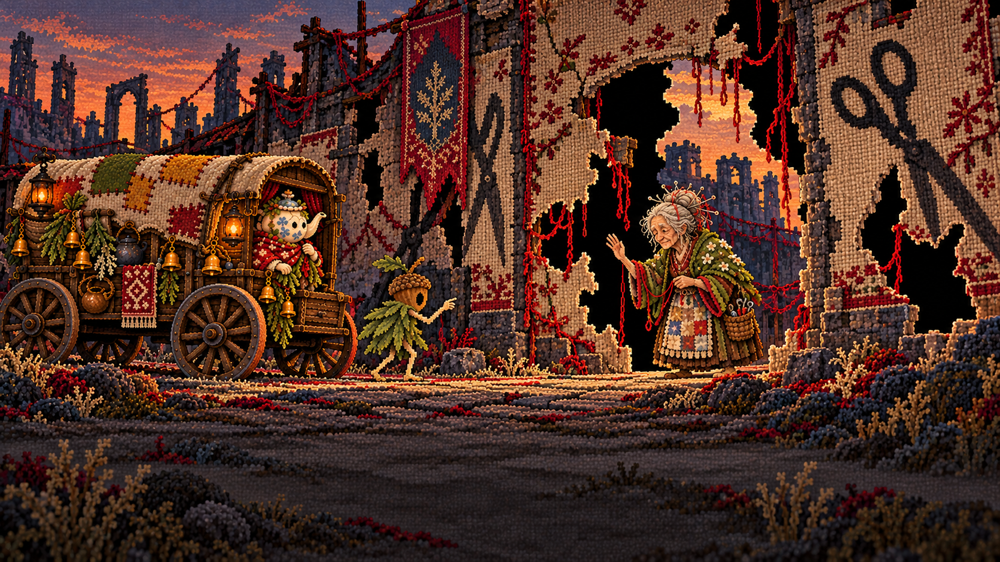 |

### 第 5 → 6 章

| 第一幕 | 第二幕 | 第三幕 |
|---|---|---|
| 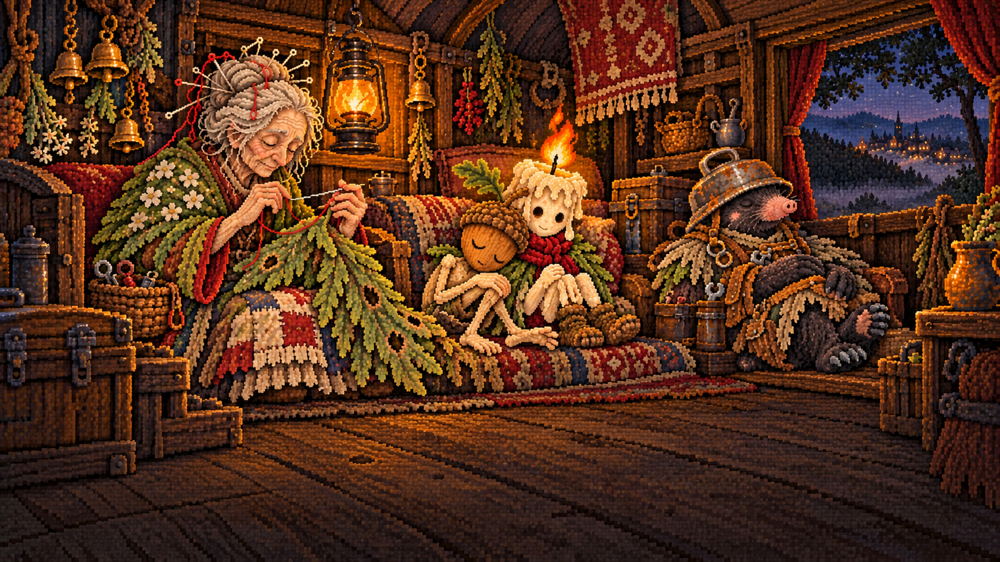 | 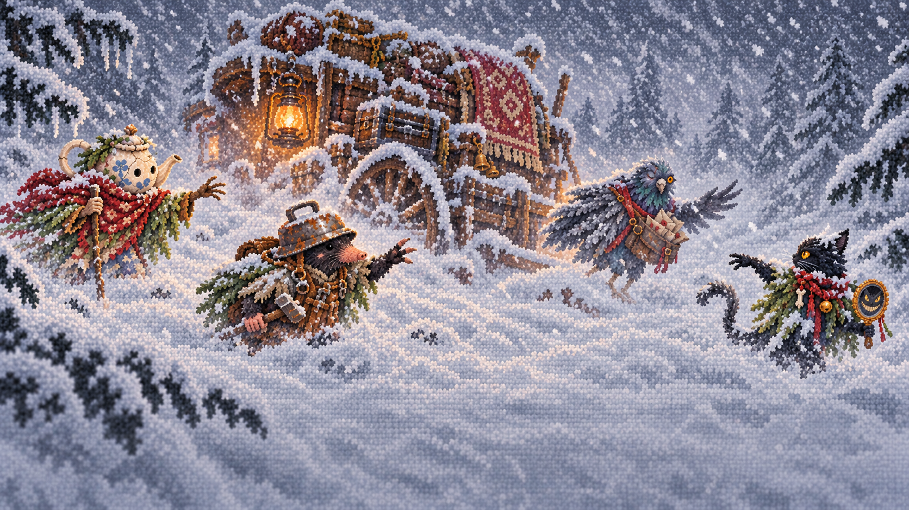 |  |

### 第 6 → 7 章

| 第一幕 | 第二幕 | 第三幕 |
|---|---|---|
|  |  | 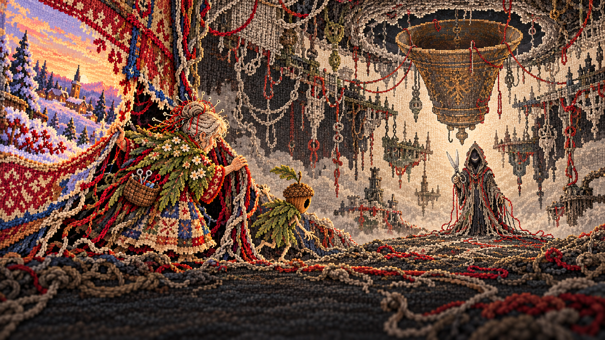 |

## 逐张检查与偏差

### clear-ch1.png
- 留白：主体下半幅；上半幅中央留白。
- 画面：钟架、举铃舌的橡果童与四位村民齐全。
- 限制：村落房屋不明显，主要表现为林间钟架与村民。

### clear-ch2.png
- 留白：主体下半幅；上方有日出亮点。
- 画面：渡灯全亮，橡果童和灯芯童向船夫挥手。
- 限制：日出与树影不是完全纯色背景，需在游戏内验证标题对比度。

### clear-ch3.png
- 留白：核心主体下半幅；左侧遗迹进入上半幅边缘。
- 画面：折叠纸鸢、松弛系绳、橡果童与信鸽；未画阅读或焚信选择。
- 限制：信鸽贴在肩旁而非明确站上肩头；上半幅左缘有遗迹。

### clear-ch4.png
- 留白：人物和回归影子位于下半幅。
- 画面：真实茶婆婆倒茶，镜猫与同行者在岸边。
- 限制：回归影子仅数个，未达到描述中的数十个；高度比目标少 1 像素。

### clear-ch5.png
- 留白：已重构：主体集中下方约四成。
- 画面：披风城门旗、绣娘收针、橡果童扶梯、鼹鼠举灯均可见。
- 限制：未发现显著构图偏差；针脚不是引擎可验证的逐像素角色复刻。

### clear-ch6.png
- 留白：人物、年兽、灶火在下半幅；边缘灯柱稍进入上半幅。
- 画面：八位家人举杯，年兽蜷睡，无实体灯芯童；炉边有未点燃残烛。
- 限制：修订后炉两侧各出现一枚残烛，多于描述的一枚；上半幅两端灯柱装饰略侵入。

### bridge-1to2-a.png
- 留白：核心事件在上四分之三；底部暗土坡。
- 画面：林冠金色声波与山坡上的小主角。
- 限制：钟声为具象金环，属于画面化表达。

### bridge-1to2-b.png
- 留白：角色和篷车在上四分之三；底部地面。
- 画面：獾行商招手，橡果童前来；作为篷车外观基准。
- 限制：布补丁和挂件在后续图中有生成式细节变化，并非完全同一贴图。

### bridge-1to2-c.png
- 留白：底部安静水面。
- 画面：蓝蘑菇、未点亮渡灯、苇丛中的微小火光。
- 限制：车上旅伴为叙事补充；远处灯芯童仅以光点暗示。

### bridge-2to3-a.png
- 留白：底部暗木地板。
- 画面：车内两名孩子、宽大毯子、背后的雾沼。
- 限制：灯芯童的形象较角色表柔和，材质细节较原精灵图细密。

### bridge-2to3-b.png
- 留白：核心篷车在上四分之三。
- 画面：已改为车头朝左上爬坡，行商扶帽；信纸无字。
- 限制：宽度比目标少 1 像素；与下一幕切换了观察侧面。

### bridge-2to3-c.png
- 留白：底部大片雾海。
- 画面：独眼信鸽叼信、满邮袋、远处三线巨鸢；司机已修正为行商。
- 限制：额外画有迎接信鸽的橡果童；未与后续镜头作像素级配准。

### bridge-3to4-a.png
- 留白：底部安静岩土。
- 画面：独眼信鸽、让座的灯芯童和微笑行商。
- 限制：空邮袋仍是正常垂挂形态，未明确折在翅膀上。

### bridge-3to4-b.png
- 留白：已上移岸线：关键倒影在上四分之三。
- 画面：茶婆婆倒茶；行商与灯芯童烤火；镜猫独坐远处石头。
- 限制：倒影为生成式绘制，不是光学或像素精确镜像。

### bridge-3to4-c.png
- 留白：关键倒影与离身影子位于底部旁白区上方。
- 画面：岸上没有茶婆婆，水中多出一位；橡果童影子离身。
- 限制：异象中的茶婆婆为正向站立而非严格倒置镜像；底部仍有低亮水纹。

### bridge-4to5-a.png
- 留白：底部地面留白。
- 画面：茶婆婆为橡果童倒热茶，镜猫已在篷车台阶。
- 限制：未同时画出所有车队成员；橡果童正面表情比侧面精灵图更拟人。

### bridge-4to5-b.png
- 留白：底部中央低对比；右侧大针脚接近旁白区。
- 画面：草与树化为刺绣形态，篷车压过大十字缝线。
- 限制：地面大针脚右端稍进入底部四分之一，需游戏内叠字检查。

### bridge-4to5-c.png
- 留白：关键角色及城门在上四分之三。
- 画面：绣娘招手、剪刀形暗影、织物城墙黑色缺口。
- 限制：缺口边缘有毛线断口，不全是干净直线剪切。

### bridge-5to6-a.png
- 留白：底部木地板留白。
- 画面：绣娘修补脱下的叶披风，橡果童已改为闭眼靠灯芯童睡，修补匠在旁休息。
- 限制：人物脸部与手部比原始低分辨率精灵更细腻。

### bridge-5to6-b.png
- 留白：底部以低对比积雪为主。
- 画面：车陷雪中，茶婆婆、修补匠、信鸽和镜猫分散伸手。
- 限制：四名角色仍较清晰，未完全淡化为模糊轮廓。

### bridge-5to6-c.png
- 留白：底部积雪留白。
- 画面：两个孩子在雪中靠近，灶爷于开门处递出小炉。
- 限制：灯芯童火苗较此前小，但仍清晰明亮；未呈濒灭点状。

### bridge-6to7-a.png
- 留白：底部暗地面留白。
- 画面：橡果童独醒，家人熟睡；仅炉火内部有孩子形光影，无实体灯芯童。
- 限制：光影已减弱，但仍比描述中的微小光点大；宽度少 1 像素；未画出灶爷。

### bridge-6to7-b.png
- 留白：底部雪地留白。
- 画面：绣娘掀起布状雪地，下面是线结与散线；仅两名主角。
- 限制：布角的暗面仍有洞口式视觉观感，但内部明确为线而非土。

### bridge-6to7-c.png
- 留白：主要角色在上四分之三；主角脚部接近界线。
- 画面：倒悬巨钟口朝上，拆线人持银剪，绣娘与橡果童进入；无灯芯童。
- 限制：终章环境参考以文字约束而非额外图片输入，受单次参考图数量限制；前景有低对比线结。

## 完整性记录

全部 PNG 已解码校验，逐字节比较选定生成原图，并记录 SHA-256 与 Git blob SHA-1；上传器会校验远端 blob，且拒绝覆盖既有文件。
机器可读清单：[asset-batch-08.json](asset-batch-08.json)。
